# Wrench Complete

Version 0.11.0, a pre-release for bug-checking. Works with BeamNG 0.40.

A complete street racing career for BeamNG.drive on **West Coast USA**, in one mod.

You start on foot with a few thousand dollars and no car. Buy a wreck, take it apart and build it back in a real garage, earn money by day, race the streets by night, and work your way up to the top of the ROC. A driver sits in every car, the rain makes the road wet, and your cars get dirty.

Wrench Complete is the whole **Wrench** family in a single download: the garage, the career, the drivers, the weather effects and parts that wear out. It is a tribute to how *Street Legal Racing: Redline* plays. Nothing from that game is included: the code is written for BeamNG, and the models and textures come from BeamNG.

## Screenshots

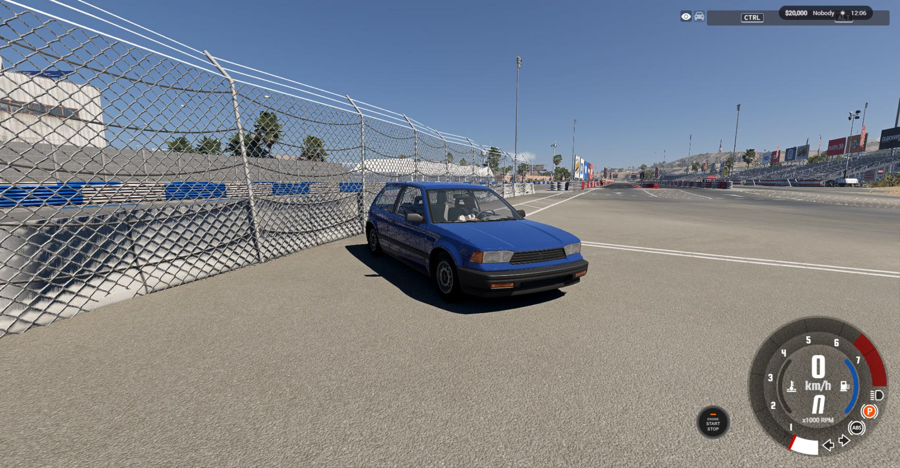
*Rain on the paint: darker, glossier, with beads of water*

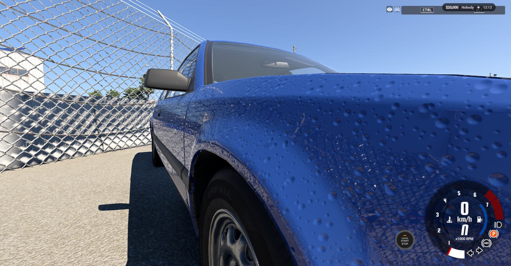
*Water beads up close*

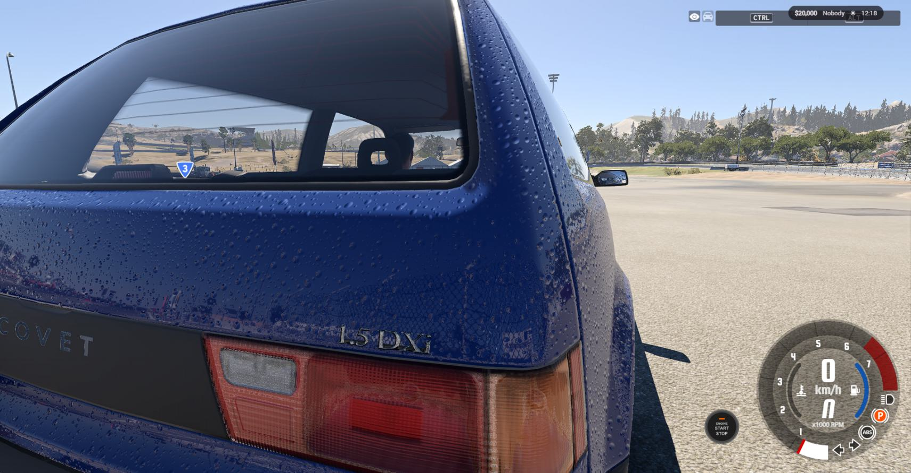
*Wet paint and trim*

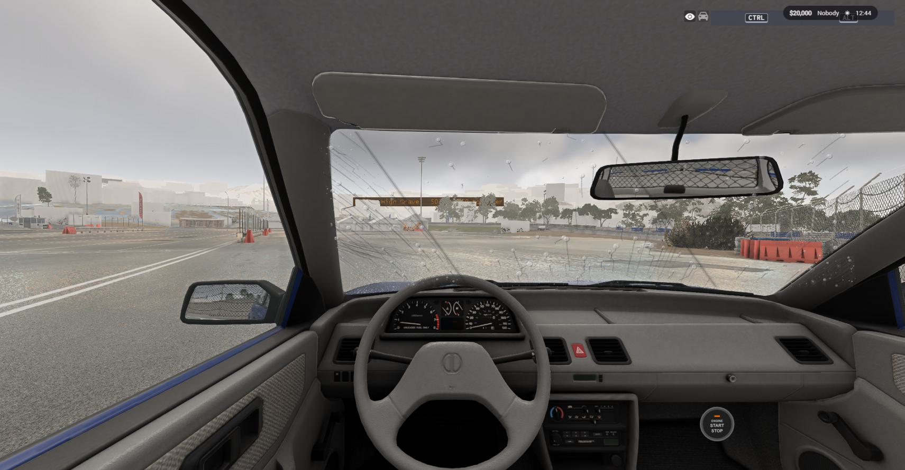
*Rain on the windscreen from the driver's seat*

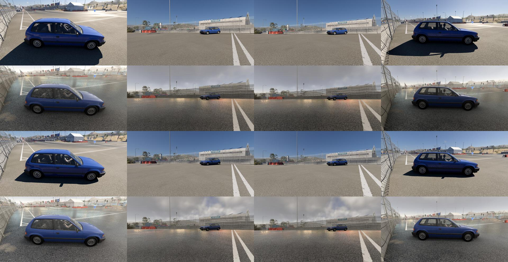
*The same road dry and wet*

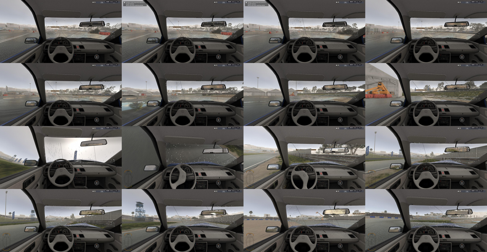
*Puddles on the road*

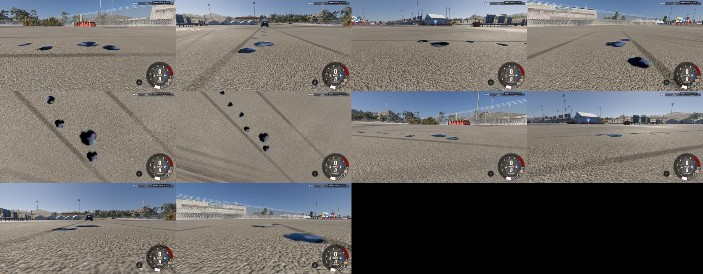
*An oil leak with a rainbow sheen*

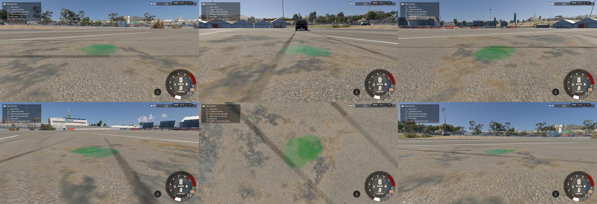
*A coolant leak*

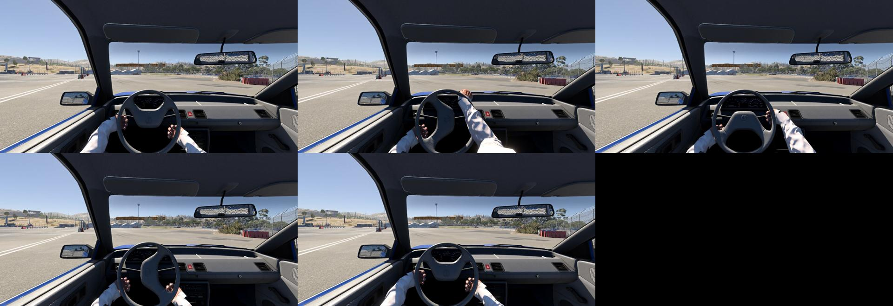
*The driver's hands on the wheel*

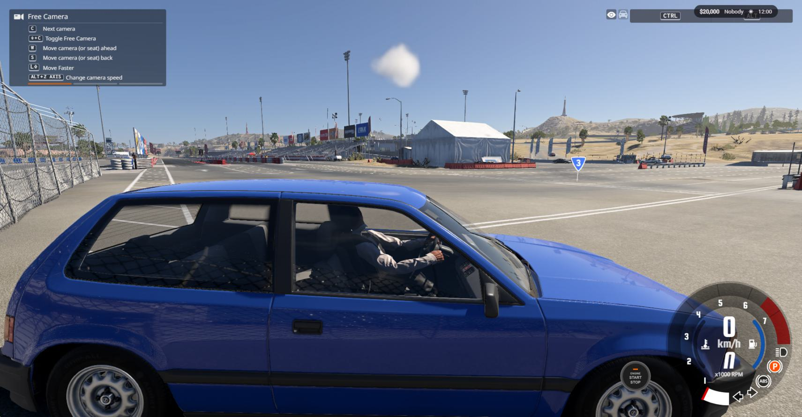
*The driver seen from outside*

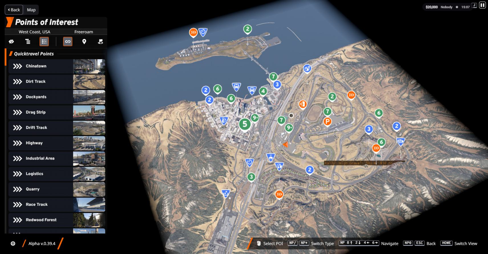
*The big map with the places*

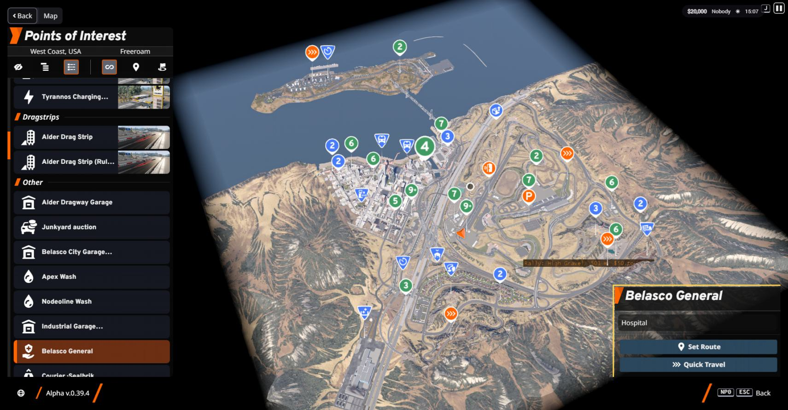
*A place on the big map*

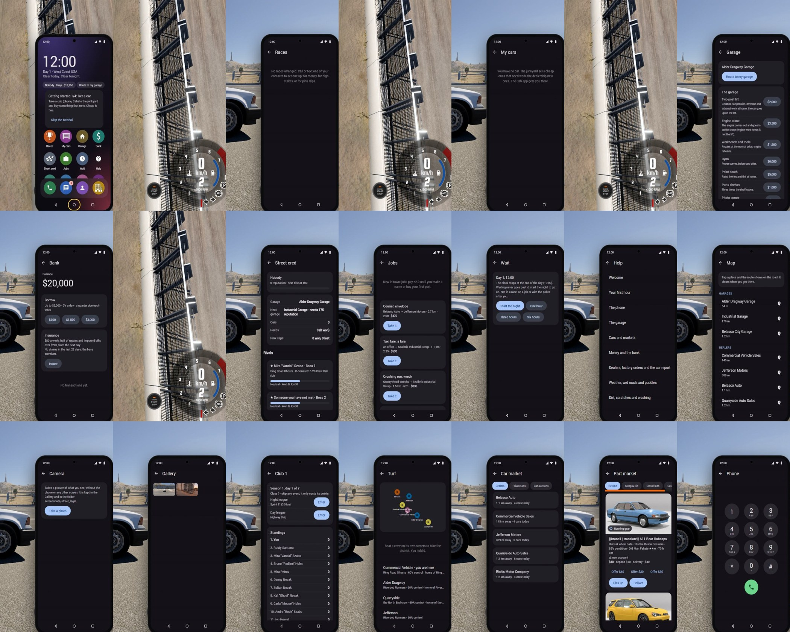
*The phone's apps*

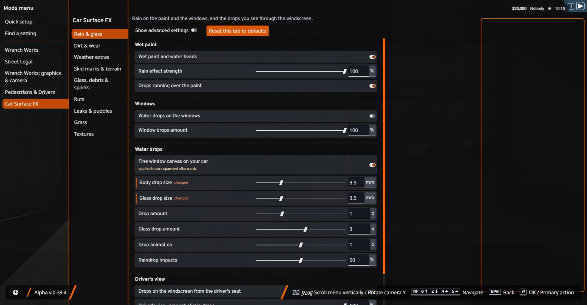
*The Mods menu (ESC > Mods)*

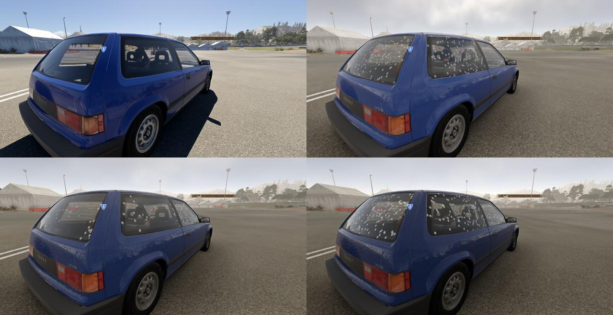
*Light, medium and heavy rain skies*

## What is in it

**Garage**
- Drive into one of four garages and the car goes onto a working lift.
- Click parts off the car and back on. Tune, paint and repair.
- Order parts for delivery or buy them over the counter at the shops in town.
- A radio plays your own music.

**Career**
- Day: jobs (towing, scrapyard runs, taxi fares, dealer deliveries), shops, dealers, track events with prize money.
- Night: street races, car meets, pink slips, the swap meet. Higher heat brings more police.
- Buy and sell cars at dealers, the junkyard, online auctions and the live junkyard auction.
- Rivals with names and texts, tier bosses, and a campaign end.
- A phone (key **K**) with messages, map, camera, bank, jobs, contacts, a cab and a help app.

**Drivers**
- A driver in every car: hands on the wheel, feet on the pedals, leaning with the car, looking where you look.
- Drivers are hurt in crashes and react to it.

**Weather and cars**
- Rain makes the road, walls and paving dark and glossy. Puddles form and the wheels throw spray.
- Wet paint with beads of water, on every car, and rain on the windscreen from the driver's seat.
- Oil and coolant leaks leave puddles with a rainbow sheen.
- Optional, off by default and still in testing (switch them on in ESC > Mods > Car Surface FX): drops on the other windows, snow, frost, bugs, road spray, ruts in soft ground, grass, and crash effects (glass, pieces, sparks).

**Part wear** (off by default: switch it on in ESC > Mods > Part wear)
- The parts of your car wear as you drive: shock absorbers, brake pads and discs, engine and more. A worn part changes how the car drives and looks (worn pads brake later, worn shocks bounce, a tired engine is slower, rust on worn metal), and you repair or replace it in the garage for money.

**Settings**
- Everything is in one place: **ESC > Mods**. Every page has a reset button and a search.
- Graphics options: anti-aliasing choices, sharpening, a colour look and a cinematic camera.

## Install

1. Download `wrench_complete.zip`.
2. Copy the zip, without unzipping it, into your BeamNG mods folder: `%LOCALAPPDATA%\BeamNG\BeamNG.drive\current\mods`.
3. **Remove the separate Wrench Works, Street Legal, Drivers & Pedestrians, Driver Injuries, Car Surface FX and Part Wear mods** if you have them. Wrench Complete already contains them, and two copies clash.
   If a separate copy is still there, Wrench Complete shows a message when a level loads (and writes it to the log) telling you which ones to remove.
4. Start BeamNG.drive. On the main menu, choose **Career**. The right-hand panel, **Wrench Works: Street Legal** (the career part of Wrench Complete keeps that name), lists your career slots: start a new career in a free slot and choose **West Coast USA**. The game's own career is the left-hand panel; leave it alone.

   **After a BeamNG update** the game turns all mods off (its `disableModsAfterUpdate` setting). Re-enable Wrench Complete in the Mods manager.

## Requirements

- BeamNG.drive 0.39 and the map **West Coast USA** (it comes with the game).
- A graphics card that runs BeamNG.drive well. The weather effects cost frames in heavy rain.

## Quick setup

Open **ESC > Mods > Quick setup** and pick a preset: **Performance**, **Balanced**, **Quality** or **Max**.

- On a laptop or a lower-spec PC, choose **Performance**. It turns the heavier effects down (puddles, rain on the car, extra graphics).
- Every setting can still be changed afterwards. **Reset this tab to defaults** puts one page back to its start values.

## Where the settings are

**ESC > Mods** has a page for each part: the career, the garage, graphics and camera, drivers and pedestrians, car surface effects and part wear. Switch on **Show advanced settings** on a page to see every option. The help for a setting shows in the panel on the right when you point at it.

## Your first hour

1. You wake up in your garage. A friend texts you: open **Messages** on the phone (**K**). The tutorial takes you through buying a car.
2. Get a car: the **Cab** app takes you to a dealer or the junkyard. Look at the cars, test drive one, buy it.
3. Drive it to your garage. The car goes onto the lift. Click a part to take it off, click a part on the shelf to fit it.
4. Earn money by day with the **Jobs** app. Spend it on parts or a better car.
5. When you are ready, open **Wait** and **Start the night**. Racers are in your **Contacts**.

The full guide is in the game: the phone's **Help** app.

## Known issues

- Wrench Complete plays on West Coast USA. The Valo City map is not part of it.
- Some features were built with offline tests and have had little play in the game yet: night race variety, the rigged driver as the default for your own car, car auctions, the phone's camera and gallery, rivals and the campaign end, and the Look and cinematic camera graphics options. Report anything that looks wrong.
- The original game's dashboard artwork is not included, so the log shows three missing images (`osd.png`, `icons/cup.png`, `general_gauge.png`). The effect on the dashboard has not been checked.
- The Mods menu help panel scrolls, but scrolling with a real mouse wheel has not been tried by a person yet.
- The optional car surface effects (drops on the windows, snow, frost, bugs, road spray, ruts, grass and crash effects) are off by default and have not been proven in the game yet. The dirt and mud look is still being improved.
- Heavy rain with 300 puddles is demanding. Lower **Puddles in the rain** or use the **Performance** preset.

## Credits

Made by Connor Moyle. Thanks to everyone who tested. Wrench Complete is a tribute to *Street Legal Racing: Redline*; it contains none of that game's files.

## Building from source

This repository holds the documentation, the changelog and the release script. The code of each part is built into one zip by `tools/release/release.py --merged wrench_complete`. See `tools/release/README.md`.
